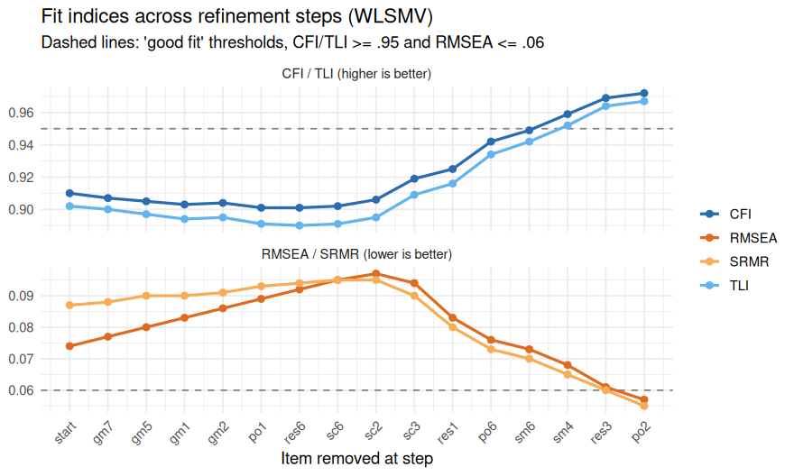
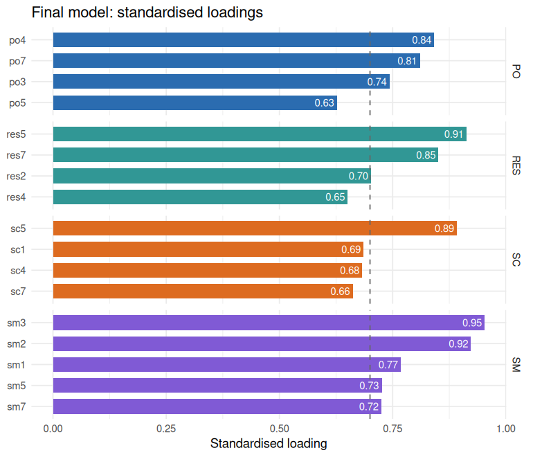

# Questionnaire validation with ordinal CFA (R + Mplus)


[](https://github.com/alex-sukhoi/scale-validation-cfa/actions/workflows/reproduce.yml)

Psychometric validation of a new multi-scale questionnaire, from raw pilot data to a final,
defensible factor structure. Built for the needs of thesis and scale-development work: every
decision is rule-based, logged in an **audit trail**, and exported as an **Mplus input file**, so a
supervisor or reviewer can check or re-run each step.

> **Data:** synthetic. A 35-item "Workplace Mental Skills" questionnaire (5 subscales × 7 items,
> 5-point Likert, n = 300) is simulated in `R/01_simulate_data.R`. The simulation builds in the problems
> real pilot data usually have (weak items, cross-loadings, an item that was not reverse-scored, a
> ceiling effect, an incomplete response), so the pipeline has something real to find.

## Pipeline


## 1. Screening

| Check | Rule | Finding | Decision |
|---|---|---|---|
| Incomplete responses | > 5 items missing | 1 respondent | Removed |
| Speeders | < 50% of median time (Greszki et al., 2014) | 5 respondents | Removed (n = 294) |
| Low variance | SD < 0.50 | None | — |
| Ceiling effect | > 70% in one category | `gm1` (74% "agree") | Kept, flagged for the CFA |
| Reverse coding | Negative r with ≥ 3 own-scale items | `gm7` (all 6 negative) | Recoded 6 − x |
| Non-normality | \|skew\| > 2, \|kurtosis\| > 7 | None (max 0.99 / 2.41) | — |

**Estimator:** the items are 5-point ordinal, so the CFA uses **WLSMV** on polychoric correlations
(Finney & DiStefano, 2013). Robust ML (MLR) is reported as a sensitivity check.

## 2. Rule-based refinement

The initial 5-factor model fit was below standard (CFI .910, TLI .902, RMSEA .074, SRMR .087). Items
were removed **one at a time with full re-estimation** (Costello & Osborne, 2005):

1. **Phase 1:** lowest standardised loading < .50
2. **Phase 2a:** in subscales with AVE < .50, lowest loading < .70
3. **Phase 2b:** while fit is below "good" (CFI/TLI ≥ .95, RMSEA ≤ .06), the item with the largest
   modification indices, i.e. the main source of cross-loadings and correlated residuals
4. **Guard:** no subscale drops below 3 items

<p align="center"></p>

The full log is in [`results/02_refinement_audit_trail.csv`](results/02_refinement_audit_trail.csv).
Each step has its own Mplus file in [`mplus/`](mplus).

| Steps | Items removed | Reason |
|---|---|---|
| 1–7 | gm7, gm5, gm1, gm2, po1, res6, sc6 | Loadings .26–.50 |
| 8–9 | sc2, sc3 | Self-Confidence AVE < .50 |
| 10–15 | res1, po6, sm6, sm4, res3, po2 | Large modification indices (cross-loading / shared-wording items) |

## 3. Competing models

| Model | Items | χ²/df | CFI | TLI | RMSEA | SRMR | WRMR |
|---|---|---|---|---|---|---|---|
| 5-factor initial | 35 | 2.59 | .910 | .902 | .074 | .087 | 1.47 |
| 5-factor refined | 20 | 1.96 | .972 | .967 | .057 | .055 | 0.93 |
| **4-factor refined (without Growth Mindset)** | **17** | 2.31 | **.972** | **.967** | .067 | .057 | 0.96 |

Growth Mindset kept an AVE of only .34 with its last 3 items, so it does not work as a separate
subscale. The recommended solution is the **4-factor, 17-item** version. Growth Mindset should be
rewritten and re-piloted rather than kept as is.

## 4. Validity of the final model

<p align="center"></p>

| Subscale | Items | α | Ordinal α | ω | AVE |
|---|---|---|---|---|---|
| Resilience | 4 | .84 | .87 | .82 | .62 |
| Stress Mindset | 5 | .88 | .90 | .92 | .68 |
| Self-Confidence | 4 | .79 | .82 | .78 | .54 |
| Performance Orientation | 4 | .81 | .84 | .81 | .58 |

- **Convergent validity:** all AVE ≥ .50, all loadings significant.
- **Discriminant validity:** Fornell–Larcker met for every pair (√AVE .74–.83 > r ≤ .71). HTMT max
  .63 < .85 (Henseler et al., 2015).
- **Sensitivity (MLR):** CFI .935, RMSEA .067, SRMR .053. The structure holds under a different
  estimator.

## Repository structure

```
R/01_simulate_data.R     synthetic pilot data + codebook
R/02_screening.R         respondent and item screening, reverse-coding check
R/03_cfa_refinement.R    WLSMV CFA, refinement loop, competing models, validity, figures
mplus/                   one Mplus .inp file per refinement step + final model
results/                 descriptives, audit trail, fit comparison, loadings, reliability, HTMT
figures/                 fit trajectory, final loadings
```

## How to run

```r
install.packages(c("lavaan", "semTools", "psych", "ggplot2"))
source("run_all.R")
```

The `mplus/*.inp` files run as they are in Mplus, using `data/analysis_sample.dat`.

## References

- Costello, A. B., & Osborne, J. (2005). Best practices in exploratory factor analysis. *Practical Assessment, Research & Evaluation, 10*, 7.
- Finney, S. J., & DiStefano, C. (2013). Nonnormal and categorical data in structural equation modeling. In *Structural equation modeling: A second course* (2nd ed., pp. 439–492). IAP.
- Fornell, C., & Larcker, D. F. (1981). Evaluating structural equation models with unobservable variables. *Journal of Marketing Research, 18*(1), 39–50.
- Greszki, R., Meyer, M., & Schoen, H. (2014). The impact of speeding on data quality in nonprobability and freshly recruited probability-based online panels. In *Online panel research* (pp. 238–262). Wiley.
- Henseler, J., Ringle, C. M., & Sarstedt, M. (2015). A new criterion for assessing discriminant validity. *Journal of the Academy of Marketing Science, 43*(1), 115–135.
- Hu, L., & Bentler, P. M. (1999). Cutoff criteria for fit indexes. *Structural Equation Modeling, 6*(1), 1–55.

---
**Author:** [Oleksii Sukhoi](https://github.com/alex-sukhoi), statistician and data analyst · [LinkedIn](https://www.linkedin.com/in/oleksii-sukhoi-4b60161a7)
